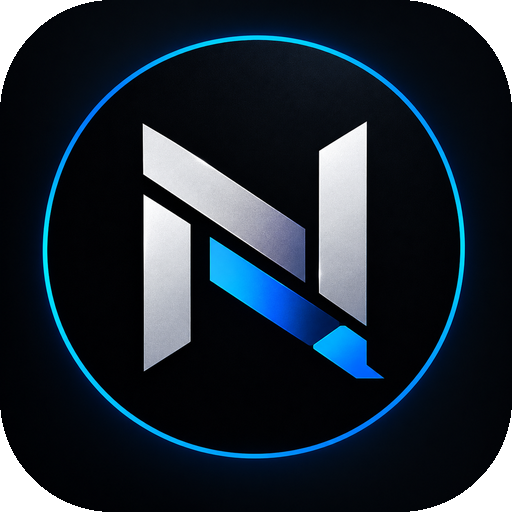
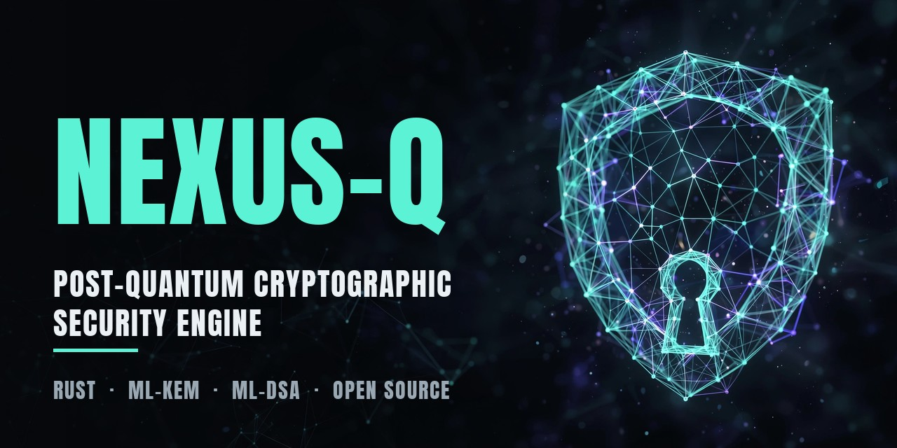
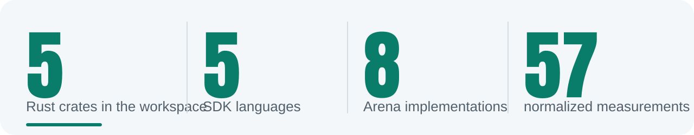
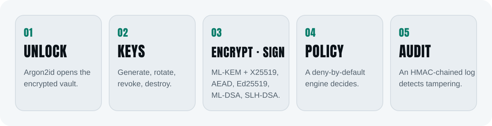
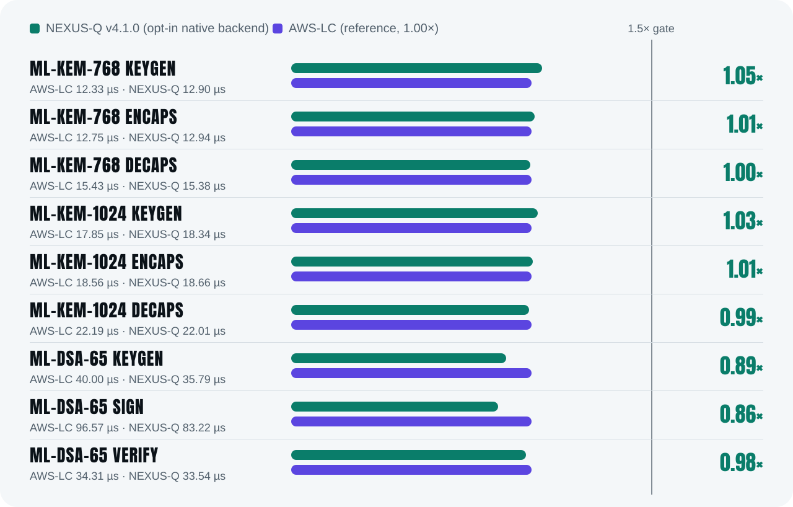
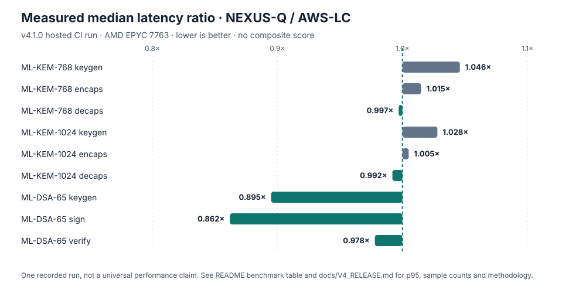

<div align="center">

<table align="center" border="0">
<tr>
<td></td>
<td><strong>NEXUS-Q is an open-source post-quantum cryptographic engine written in Rust</strong></td>
</tr>
</table>



[](https://github.com/lecodev-26/nexus-q/actions/workflows/ci-pipeline.yml) [](https://github.com/lecodev-26/nexus-q/actions/workflows/native-runtime.yml) [](https://github.com/lecodev-26/nexus-q/actions/workflows/sdk-runtime.yml) [](https://opensource.org/license/mit)

<a href="https://nexus-q.link"><picture><source media="(prefers-color-scheme: dark)" srcset="assets/dark/b-site.svg"></picture></a>&nbsp;<a href="https://github.com/lecodev-26/nexus-q/releases/latest"><picture><source media="(prefers-color-scheme: dark)" srcset="assets/dark/b-rel.svg"></picture></a>&nbsp;<a href="docs/user/README.md"><picture><source media="(prefers-color-scheme: dark)" srcset="assets/dark/b-docs.svg"></picture></a>&nbsp;<a href="SECURITY.md"><picture><source media="(prefers-color-scheme: dark)" srcset="assets/dark/b-sec.svg"></picture></a>

**Protecting data, keys, and identities with standardized cryptography and an auditable security workflow.**<br>A plain-language tour of the project lives on the website: [nexus-q.link](https://nexus-q.link).

</div>

> **Current project status (checked 2026-10-23):** GitHub release [v4.1.1](https://github.com/lecodev-26/nexus-q/releases/tag/v4.1.1) is published and its Git tag points to the current [`main` branch](https://github.com/lecodev-26/nexus-q/tree/main). Important: the existing `nexusq-v4.1.1-provenance.json` still records commit [`5dd564d`](https://github.com/lecodev-26/nexus-q/commit/5dd564daab9da1c071b8b134894ea7c4eba95d09), and the previously published release binaries, checksums and SBOM were not regenerated when the tag moved. The tag therefore points to `main`, but the existing release assets do not yet have matching provenance for that commit. The release-tag manifest declares Rust 1.85, while current `main` declares Rust 1.88; the 1.88 requirement below applies to building current `main`, not automatically to every published package. Public endpoint checks confirm 4.1.1 availability for published crates.io packages, PyPI (`nexusq`, source distribution only), npm, RubyGems, Packagist, pub.dev, NuGet (`Nexusq`), and Maven Central Java (`io.github.lecodev-26:nexusq`) and Kotlin (`io.github.lecodev-26:nexusq-kotlin`) artifacts. These checks establish registry availability, not source-commit provenance for every registry package. `nexusq-pki-cluster 4.1.1` was successfully published to crates.io on 2026-10-23 after updating the Cargo API token. The successful upload was confirmed by Cargo; public registry propagation may take a short time. `nexusq-hsm` is published. The NuGet 4.1.1 archive contains the .NET 9 assembly and native runtime assets for Linux x64/ARM64, macOS ARM64 and Windows x64; its publish workflow completed successfully for `main` commit `5b8a663` on 2026-10-23 ([run details](https://github.com/lecodev-26/nexus-q/actions/runs/39909889694)). Maven POM, JAR, sources JAR and Javadoc JAR endpoints returned HTTP 200 for both 4.1.1 artifacts. The Go module uses its own `v0.1.0` version. SwiftPM's bare `4.1.1` tag still resolves to the original release commit `5dd564d`; Git tag `v4.1.1` points to current `main`. These tags are not equivalent. SwiftPM users must not assume these two tags identify the same source snapshot. The native ML-KEM/ML-DSA backend remains experimental and opt-in; RustCrypto remains the default production path. CI run [`39820696137`](https://github.com/lecodev-26/nexus-q/actions/runs/39820696137) for `main` commit `5b8a663` completed successfully: 62 jobs passed, two optional/manual jobs were skipped, and none failed. Its Cargo audit and Cargo deny jobs passed. The previously reported `time` advisory was addressed by updating the lockfile to `time 0.3.47`. On 2026-10-23, the newly published `RUSTSEC-2026-0385` advisory for `ctutils 0.4.2` was addressed by updating the workspace and native-backend lockfiles to `ctutils 0.4.4` (the advisory fix requires Rust 1.87; current `main` requires Rust 1.88). Both lockfiles are covered by the native-backend security workflow. The Swift SDK workflow now retries its C runtime build up to three times to tolerate transient crates.io DNS/registry failures observed on hosted macOS runners; persistent failures still fail the job. `RUSTSEC-2023-0071` for `rsa` remains an explicitly documented exception in [`.cargo/audit.toml`](.cargo/audit.toml) and [`deny.toml`](deny.toml); this is not a claim that every advisory is fixed. No independent external audit, FIPS 140-3 validation, certification, or production-readiness claim is made. See [`docs/V4_RELEASE.md`](docs/V4_RELEASE.md) and [`docs/NATIVE_RUNTIME_PACKAGING.md`](docs/NATIVE_RUNTIME_PACKAGING.md).

## Quick navigation

| Start here | Explore deeper |
|---|---|
| [Overview and design](#overview) · [Cryptography](#cryptography) · [Quick start](#quick-start) | [Architecture](docs/ARCHITECTURE.md) · [Threat model](docs/THREAT_MODEL.md) · [Security model](docs/SECURITY_MODEL.md) |
| [Benchmarks and measured results](#benchmarks) · [Installation](#installation) | [Benchmark Arena and methodology](arena/README.md) · [Benchmark index](BENCHMARKS.md) · [Performance reports](docs/performance/) |
| [Project status and versions](#status) · [Security and assurance](#security-and-assurance) | [Roadmap](docs/ROADMAP.md) · [Release notes](docs/V4_RELEASE.md) · [Security policy](SECURITY.md) |
| [Documentation index](#documentation) · [Contributing](#contributing) · [License](#license) | [Website](https://nexus-q.link) · [Releases](https://github.com/lecodev-26/nexus-q/releases) · [Discussions](https://github.com/lecodev-26/nexus-q/discussions) |

### Project at a glance

| Item | Current project position |
|---|---|
| Language | Rust, edition 2024 |
| Current `main` toolchain | Rust 1.88 or newer; see the release-provenance note above before assuming published artifacts match `main` |
| Cryptography | Standardized classical and post-quantum primitives; see [Cryptography](#cryptography) and [`docs/CRYPTOGRAPHY.md`](docs/CRYPTOGRAPHY.md) |
| Default implementation path | RustCrypto; the native backend is experimental and opt-in |
| Interfaces | Rust library, CLI, server, C ABI and language SDKs; availability and packaging vary by ecosystem |
| License | MIT OR Apache-2.0 |
| Assurance boundary | Security CI, fuzz targets and documented threat model; no independent external audit or certification claimed |

## Capability and maturity matrix

This is a quick orientation, not a substitute for the per-module documentation or release provenance. “Available” means the repository has an implemented path; it does not imply independent audit or certification.

| Status | Capability | Qualification |
|---|---|---|
| Available | Rust core, CLI, server, vault/storage workflows, policy checks, audit logging and documented SDK bindings | Verify the specific package, target and release status in [Installation](#installation) and its binding guide. |
| Available | Standardized cryptographic algorithms via the default RustCrypto path, including ML-KEM/ML-DSA capability in the project | Algorithm support at the library level does not mean every CLI command or SDK exposes every operation. |
| Experimental / opt-in | Native ML-KEM/ML-DSA backend behind `native-backend` | Not enabled by default in core, CLI, server or SDKs; not independently audited. See [native backend notes](docs/performance/NATIVE_BACKEND_FEATURE.md). |
| Integration-specific | HSM module and hardware-provider abstractions | Do not infer that a particular HSM, TPM, Secure Element or enclave is supported or provides hardware isolation without checking the relevant adapter and deployment docs. |
| Planned / target-dependent | Hardware-backed isolation and platform-specific integrations | Treat roadmap entries as plans until an implementation, supported device matrix and CI evidence are linked. |

## Security model at a glance

| Question | Current documented position | Important limit |
|---|---|---|
| Which adversaries are considered? | Network attackers and local unprivileged attackers, with trust boundaries detailed in the [threat model](docs/THREAT_MODEL.md). | A compromised endpoint, privileged attacker or malicious build/release infrastructure can defeat assumptions; consult the full threat model. |
| What happens if vault files are stolen? | Vault data is encrypted at rest and key material is managed through the vault/key lifecycle. | Protection depends on password strength, correct deployment and the attacker not obtaining unlock secrets or process memory. |
| What if the device is already compromised? | Zeroization, policy checks and audit controls provide defense-in-depth. | They do not guarantee protection from an attacker controlling the running process, OS or privileged account. |
| What if a password is lost? | Follow the documented backup and recovery procedures for the configured vault. | Do not assume a password reset or recovery path can recover cryptographic secrets; keep verified backups and test recovery before production use. |
| Has an external audit or certification been completed? | No independent external audit or FIPS 140-3 / Common Criteria certification is claimed. | Automated tests, fuzzing, CI, benchmarks and package publication are not substitutes for independent review. |
| Are all dependency advisories resolved? | Dependency scanning is part of the security workflow. | `RUSTSEC-2023-0071` for `rsa` remains a documented exception in [audit configuration](.cargo/audit.toml) and [`deny.toml`](deny.toml); review current CI and advisory status. |

## Modules and SDKs

The repository separates the cryptographic core from interfaces, optional services, and language bindings. These names describe repository components, not a claim that every package has identical maturity, platform support, or release provenance. Use the installation table and each binding's own documentation to confirm the package and target you need.

| Area | Main components | Purpose / boundary |
|---|---|---|
| Core and primitives | `nexusq-core`, `nexusq-kernels`, `nexusq-ml-kem`, `nexusq-ml-dsa` | Core security logic and algorithm-focused crates |
| Application interfaces | `nexusq`, `nexusq-cli`, `nexusq-server` | Aggregate Rust API, command-line interface, authenticated HTTP service |
| Native integration | `nexusq-c`, `nexusq-cpp`, `nexusq-py` | C/C++ integration and Python extension/binding |
| Optional services | `nexusq-admin`, `nexusq-enrollment`, `nexusq-ha`, `nexusq-hsm`, `nexusq-ocsp`, `nexusq-pki-cluster`, `nexusq-tsa`, `nexusq-x509` | Administration, enrollment, high availability, hardware integration and PKI-related modules; consult individual docs for operational scope |
| Language bindings | `bindings/` | Dart, .NET, Go, Java, Kotlin, PHP, Ruby, Swift and TypeScript/Node.js |
| Performance evidence | `arena/`, `BENCHMARKS.md`, `docs/performance/` | Benchmark adapters, methodology, measured reports and historical engineering decisions |

The repository already includes visual assets for the architecture flow, project overview and benchmark comparisons. Benchmark visuals are based on the documented measurements; consult the accompanying tables and run-specific notes rather than treating a graphic as a standalone performance guarantee.

<div align="center">

<picture><source media="(prefers-color-scheme: dark)" srcset="assets/dark/stats.svg"></picture>

</div>

<div align="center">

<picture><source media="(prefers-color-scheme: dark)" srcset="assets/dark/h-overview.svg"></picture>

</div>

## Overview

NEXUS-Q is a post-quantum cryptographic security engine designed to protect:

| 🔒 Data | 🗝️ Keys | 🪪 Identities |
|---|---|---|
| Authenticated encryption of files and streams. | Full lifecycle management: generation, rotation, revocation, destruction. | Digital signatures and verifiable credentials. |

It is intended as a cryptographic/security engine for applications and servers. The repository also defines hardware-provider abstraction points for future TPM, HSM, Secure Element, enclave and RISC-V integrations; the default software backend does not itself provide hardware isolation.

<div align="center">

<picture><source media="(prefers-color-scheme: dark)" srcset="assets/dark/h-how.svg"></picture>

</div>

<div align="center">

<picture><source media="(prefers-color-scheme: dark)" srcset="assets/dark/flow.svg"></picture>

</div>

Every operation goes through the same building blocks: a password unlocks an encrypted vault (format F-01, atomic writes), keys are managed through their full lifecycle, data is protected with envelope encryption (format F-02), a deny-by-default policy engine gates actions, and security-relevant events go to an HMAC-authenticated audit log with rollback anchoring.

<div align="center">

<picture><source media="(prefers-color-scheme: dark)" srcset="assets/dark/h-principles.svg"></picture>

</div>

1. **We do not invent cryptography.** Only standardized algorithms and maintained cryptographic libraries; dependency audit status is documented explicitly.
2. **Library-first.** The core is a Rust library; the CLI, SDKs and server are layers on top.
3. **Hardware-agnostic boundary.** Hardware-provider interfaces are separated from the software backend; concrete hardware isolation is only claimed when a provider is implemented and tested.
4. **Zeroization.** Secrets are wiped from memory when no longer needed.
5. **Auditability.** Auditable security state changes and cryptographic actions are recorded in a tamper-evident, HMAC-authenticated log.
6. **Security from the ground up.** Threat model and cryptographic rules before code.

<div align="center">

<picture><source media="(prefers-color-scheme: dark)" srcset="assets/dark/h-layout.svg"></picture>

</div>

| Component | What it is |
|---|---|
| `crates/nexusq-core` | The library. All cryptography, vault, key management, identity, policy, storage and hardware abstraction live here. |
| `crates/nexusq-cli` | The `nexusq` binary. A thin wrapper over the library; no cryptography. |
| `crates/nexusq-server` | The `nexusq-server` binary and authenticated HTTP service. |
| `crates/nexusq-c` · `crates/nexusq-py` | The C SDK and the Python binding. |
| `bindings/` | Go, PHP and Ruby bindings. |
| `arena/` | The PQC Benchmark Arena: pinned external implementations and normalized JSONL output. |
| `fuzz/` · `artifact-archive/` | Fuzz targets and the archived V1/V2/V3 evidence with SHA-256 manifests. |
| `docs/` · `deploy/` · `examples/` | Documentation, release packaging and C examples. |

**Current `main` build requirements:** Rust 1.88 or newer (edition 2024, matching the current `Cargo.toml` MSRV) and Git. Published packages may have different source provenance and MSRV; check the specific package metadata when targeting an older toolchain. Additional SDK toolchains are only required when building a specific binding (C/C++, Python, Go, Ruby).

**Target platforms:** Linux (x86_64, aarch64); Android / Termux (aarch64); RISC-V (`riscv64gc-unknown-linux-gnu`), build verified; macOS and Windows release builds are validated by the V2 CI/release gate.

<div align="center">

<picture><source media="(prefers-color-scheme: dark)" srcset="assets/dark/h-crypto.svg"></picture>

</div>

## Cryptography

| Family | Purpose | Implemented |
|---|---|---|
| Randomness | Entropy for keys, nonces and salts | OS CSPRNG, TRNG support with health checks and mixing |
| Hashing | Digests and commitments | SHA-2, SHA-3 |
| KDF | Passwords and key material to keys | Argon2id, HKDF |
| AEAD | Symmetric authenticated encryption | AES-256-GCM, ChaCha20-Poly1305 |
| KEM | Post-quantum key encapsulation | ML-KEM-768 and ML-KEM-1024, hybrid with X25519 |
| Signatures | Authenticity | Ed25519, ML-DSA-65, SLH-DSA-SHAKE-128f |

The reference document is [`docs/CRYPTOGRAPHY.md`](docs/CRYPTOGRAPHY.md). Planned algorithms must not be described as available until they are implemented and tested.

<div align="center">

<picture><source media="(prefers-color-scheme: dark)" srcset="assets/dark/h-status.svg"></picture>

</div>

## Status

**Completed:**

- Foundation documents, threat model, cryptographic rules.
- Crypto core: ML-KEM-768 hybrid with X25519, AES-256-GCM, ChaCha20-Poly1305, Ed25519, SHA-2, SHA-3, Argon2id, HKDF.
- Key management with full lifecycle.
- Encrypted vault (format F-01) with atomic writes.
- Envelope encryption (format F-02).
- Identities with signing, verification, rotation, revocation and signed credentials.
- Hardware abstraction traits for software, TPM, HSM, Secure Element and RISC-V.
- TRNG support with health checks and mixing.
- Cross-compilation to RISC-V verified.
- Storage: HMAC-authenticated audit log with rollback anchoring, backup bundle, storage DB.
- Policy engine with deny-by-default.
- CLI covering vault, key, data, sign, identity, credential and audit commands.

<div align="center">

<picture><source media="(prefers-color-scheme: dark)" srcset="assets/dark/h-bench.svg"></picture>

</div>

## Benchmarks

The benchmark tables below intentionally retain the recorded measurements, historical comparisons, and known caveats. They are real project benchmark results, not illustrative figures. Each dataset has its own context: local diagnostics, hosted-runner release gates, and historical Arena runs must not be compared as if they were one controlled experiment.

For reproducibility and fuller context, start with the [PQC Benchmark Arena documentation](arena/README.md), the [benchmark index](BENCHMARKS.md), the [V4 release notes](docs/V4_RELEASE.md), and the linked per-run CI artifacts/reports. Hardware, CPU governor, runner environment, sample count, warmups, comparator versions, and aggregation method matter. Latency ratios are operation-specific; there is no composite score here. Lower latency is better, and a benchmark pass is not an end-to-end application performance or security certification claim.

NEXUS-Q is **not presented as a universal performance leader**. In the 2026-10-21 local x86-64 benchmark, the opt-in native backend was compared with the best eligible per-operation comparator using a matched AWS-LC RNG. Six of nine operations beat the comparator on both median and p95; the other three are close to parity: ML-DSA-65 signing (1.063× median / 1.115× p95), ML-KEM-1024 key generation (1.021× / 1.020×), and ML-KEM-768 key generation (1.015× / 1.013×). This is local diagnostic evidence from an Intel Core i3-N305 with the CPU governor set to `powersave`, not a hosted-runner release benchmark or a universal performance claim. The project owner accepted this result as sufficient to complete Issue [#23](https://github.com/lecodev-26/nexus-q/issues/23), treating 1.00× as an ideal target rather than an absolute closure requirement; the remaining deltas are documented in [`docs/performance/ISSUE_23_FINAL_GATE_AUDIT_2026-10-21.md`](docs/performance/ISSUE_23_FINAL_GATE_AUDIT_2026-10-21.md). The default `nexusq-core` build, CLI and SDKs still use RustCrypto for production call paths; the native path is opt-in and experimental. Lower latency is better.

<div align="center">

<picture><source media="(prefers-color-scheme: dark)" srcset="assets/dark/bars.svg"></picture>

</div>

<sub>v4.1.0 stable line, 2026-10-19: official 1.5× median-and-p95 production-path gate (opt-in native backend vs AWS-LC) from the green release CI on the merged v4.1.0 code — three alternating rounds per implementation, pooled medians and nearest-rank p95, 3,000 samples per operation per implementation on an AMD EPYC 7763 CI runner. The full PQC Benchmark Arena run of the same release (241 normalized measurements, eight comparators plus the V1/V1+zeroize/V3 controls) is retained as CI artifacts. Reported without a composite score.</sub>

<div align="center">



</div>

| Operation | NEXUS-Q | AWS-LC | NEXUS-Q / AWS-LC |
|---|---:|---:|---:|
| ML-KEM-768 keygen | 12.90 µs | 12.33 µs | 1.05× |
| ML-KEM-768 encaps | 12.94 µs | 12.75 µs | 1.01× |
| ML-KEM-768 decaps | 15.38 µs | 15.43 µs | 1.00× |
| ML-KEM-1024 keygen | 18.34 µs | 17.85 µs | 1.03× |
| ML-KEM-1024 encaps | 18.66 µs | 18.56 µs | 1.01× |
| ML-KEM-1024 decaps | 22.01 µs | 22.19 µs | 0.99× |
| ML-DSA-65 keygen | 35.79 µs | 40.00 µs | 0.89× |
| ML-DSA-65 sign | 83.22 µs | 96.57 µs | 0.86× |
| ML-DSA-65 verify | 33.54 µs | 34.31 µs | 0.98× |

<details>
<summary><b>v1.0 Arena baseline (historical)</b></summary>

The v1 baseline was slower than the fastest mature implementations on the measured ML-KEM and ML-DSA operations; closing that gap was the primary engineering target of the V4 line.

<sub>Final v1.0 Arena run, 2026-10-05: 57 normalized measurements from eight implementations on the same x86_64 Linux CI environment, 20 iterations and 3 warmups. Reported without a composite score. Comparators: AWS-LC, Botan, CIRCL, liboqs, OpenSSL, PQ Code Package and RustCrypto KEMs. Raw measurements are retained as CI artifacts.</sub>

| Operation | NEXUS-Q v1 | Best measured comparator | NEXUS-Q v1 / best |
|---|---:|---:|---:|
| ML-KEM-768 keygen | 33.94 µs | AWS-LC, 11.44 µs | 2.97× |
| ML-KEM-768 encaps | 27.97 µs | AWS-LC, 12.11 µs | 2.31× |
| ML-KEM-768 decaps | 34.62 µs | AWS-LC, 15.07 µs | 2.30× |
| ML-KEM-1024 keygen | 53.89 µs | liboqs, 22.60 µs | 2.38× |
| ML-KEM-1024 encaps | 46.05 µs | liboqs, 22.71 µs | 2.03× |
| ML-KEM-1024 decaps | 52.14 µs | liboqs, 25.61 µs | 2.04× |
| ML-DSA-65 keygen | 168.69 µs | AWS-LC, 44.21 µs | 3.82× |
| ML-DSA-65 sign | 600.73 µs | AWS-LC, 134.75 µs | 4.46× |
| ML-DSA-65 verify | 101.20 µs | CIRCL, 22.92 µs | 4.42× |

</details>

<details>
<summary><b>V1 vs V2 (same-runner Arena comparison)</b></summary>

The final benchmark record does not claim a performance improvement over V1. Corrected Arena runs produced geometric means of 0.885 and 1.0647513576 V2/V1, so performance remains an unresolved investigation item rather than a validated regression or improvement. The latest same-runner comparison measured V2 at +0.22% to +52.37% latency versus V1 across the nine NEXUS-Q operations; ML-DSA-65 signing is the dominant outlier at +52.37%.

| Operation | V1 | V2 | V2/V1 | Difference |
| --- | ---: | ---: | ---: | ---: |
| ML-KEM-768 keygen | 49.819 us | 51.185 us | 1.0274 | +2.74% |
| ML-KEM-768 encaps | 45.081 us | 46.063 us | 1.0218 | +2.18% |
| ML-KEM-768 decaps | 54.537 us | 55.997 us | 1.0268 | +2.68% |
| ML-KEM-1024 keygen | 81.264 us | 82.191 us | 1.0114 | +1.14% |
| ML-KEM-1024 encaps | 72.041 us | 73.221 us | 1.0164 | +1.64% |
| ML-KEM-1024 decaps | 83.992 us | 84.859 us | 1.0103 | +1.03% |
| ML-DSA-65 keygen | 283.730 us | 284.344 us | 1.0022 | +0.22% |
| ML-DSA-65 sign | 620.367 us | 945.226 us | 1.5237 | **+52.37%** |
| ML-DSA-65 verify | 181.798 us | 181.479 us | 0.9982 | -0.18% |

These are same-runner reference measurements from the retained Arena JSONL artifacts. The previous corrected run measured 0.885 V2/V1, demonstrating substantial run-to-run variance; V3 therefore begins with profiling and benchmark-variance investigation rather than assuming a single-run regression. See [`docs/V2_PERFORMANCE_RESULTS.md`](docs/V2_PERFORMANCE_RESULTS.md). Performance investigation is intentionally deferred to V3; V2 is not being modified to manufacture a benchmark result.

</details>

<details>
<summary><b>V1 vs V3 (paired investigation)</b></summary>

The paired V1/V3 investigation found median increases of +2.70% to +6.33% across the six measured ML-KEM operations in the recorded hosted-runner experiment; conventional ML-DSA verification was +6.40%, key generation +6.82%, and signing median -0.76%. These are observations from one CI runner and ten paired rounds, not universal performance claims. See [`BENCHMARKS.md`](BENCHMARKS.md) and the [forensic report](arena/results/issue-41-v1-v3-latency-root-cause.md).

The ML-DSA-only zeroize control does not prove SHA3/SHAKE zeroization is the cause of the ML-KEM latency delta. Issue #41 was closed by explicit project decision: V1 prioritizes speed, while V3 retains security hardening and accepts the observed performance cost.

</details>

<details>
<summary><b>V4.1.0 stable line (Arena run and production-path gate)</b></summary>

The v4.1.0 stable line release was validated on `main` with the full PQC Benchmark Arena and the official 1.5× median-and-p95 production-path gate; both are green on the release code (a post-merge compile fix for the pinned Rust 1.85.1 release toolchain landed as [PR #57](https://github.com/lecodev-26/nexus-q/pull/57)).

**Arena run (2026-10-19, commit [`70152eb`](https://github.com/lecodev-26/nexus-q/commit/70152ebcf92c7edfa97c99c5f767a43ecce1aa00)):** 241 normalized measurements on the same `ubuntu-24.04` x86_64 CI environment, 20 iterations and 3 warmups per operation. Comparators: AWS-LC (`ec05f25`), Botan 3.13.0, OpenSSL 3.5.9, CIRCL 1.6.4, RustCrypto KEMs, liboqs 0.16.0 and PQ Code Package, plus the retained V1 / V1+zeroize / V3 controls. Raw JSONL measurements are retained as [CI artifacts of the Arena run](https://github.com/lecodev-26/nexus-q/actions/runs/39186079459); reported without a composite score.

**Production-path gate (native backend vs AWS-LC, three alternating rounds per implementation, pooled medians and nearest-rank p95, 3,000 samples per operation per implementation):** all nine operations passed the unchanged 1.5× median-and-p95 gate on the merged release code ([gate run](https://github.com/lecodev-26/nexus-q/actions/runs/39182674176)).

| Operation | NEXUS-Q median | NEXUS-Q p95 | AWS-LC median | Median ratio | p95 ratio | Gate |
|---|---:|---:|---:|---:|---:|---|
| ML-KEM-768 keygen | 12.90 µs | 13.38 µs | 12.33 µs | 1.046 | 1.041 | pass |
| ML-KEM-768 encaps | 12.94 µs | 13.00 µs | 12.75 µs | 1.015 | 1.013 | pass |
| ML-KEM-768 decaps | 15.38 µs | 15.44 µs | 15.43 µs | 0.997 | 0.994 | pass |
| ML-KEM-1024 keygen | 18.34 µs | 18.86 µs | 17.85 µs | 1.028 | 1.025 | pass |
| ML-KEM-1024 encaps | 18.66 µs | 18.76 µs | 18.56 µs | 1.005 | 0.985 | pass |
| ML-KEM-1024 decaps | 22.01 µs | 22.10 µs | 22.19 µs | 0.992 | 0.977 | pass |
| ML-DSA-65 keygen | 35.79 µs | 36.62 µs | 40.00 µs | 0.895 | 0.885 | pass |
| ML-DSA-65 sign | 83.22 µs | 235.40 µs | 96.57 µs | 0.862 | 0.846 | pass |
| ML-DSA-65 verify | 33.54 µs | 34.01 µs | 34.31 µs | 0.978 | 0.976 | pass |

These are single-runner CI measurements on an AMD EPYC 7763 hosted runner, not universal performance claims. The native backend remains experimental and opt-in; the default `nexusq-core` build, the CLI and the SDKs still use RustCrypto for production call paths. See [`docs/performance/NATIVE_BACKEND_FEATURE.md`](docs/performance/NATIVE_BACKEND_FEATURE.md) and [`docs/V4_RELEASE.md`](docs/V4_RELEASE.md).

</details>

<div align="center">

<picture><source media="(prefers-color-scheme: dark)" srcset="assets/dark/h-versions.svg"></picture>

</div>

| Line | Reference | Current meaning | Status |
|---|---|---|---|
| V1 | [`v1.0.0`](https://github.com/lecodev-26/nexus-q/releases/tag/v1.0.0) | Original frozen baseline | Historical engineering baseline |
| V2 | [`v2.0.0`](https://github.com/lecodev-26/nexus-q/releases/tag/v2.0.0) · `nexusqv2` | Security/correctness engineering line | Frozen |
| V3 | [`v3-engineering-2026-10-09`](https://github.com/lecodev-26/nexus-q/releases/tag/v3-engineering-2026-10-09) · `nexusqv3` | Hardened implementation and benchmark evidence | Engineering release |
| V4 | [`v4-engineering-2026-10-16`](https://github.com/lecodev-26/nexus-q/tree/v4-engineering-2026-10-16) · `nexusqv4` | Experimental native backend and performance work | Engineering snapshot (pre-release) |
| V4.1.1 | [`v4.1.1`](https://github.com/lecodev-26/nexus-q/releases/tag/v4.1.1) · `main` | Published release; registry availability is tracked in the installation table | **Released; independent external audit remains open** |
| V4.1 | [`v4.1.0`](https://github.com/lecodev-26/nexus-q/releases/tag/v4.1.0) · `main` | Previous stable line release: opt-in native-backend production-path wiring | Historical release; independent external audit remains pending (Phase 21) |

<details>
<summary><b>V3 engineering release and V4 snapshot</b></summary>

V3 consolidates the hardened implementation, reproducible PQC Benchmark Arena, dependency/profile diagnostics, corrected benchmark sampling and archived evidence. Its GitHub release is an engineering release, not a claim of independent audit, certification, or registry publication. V1/V2/V3 artifacts and checksums are indexed in [`artifact-archive/README.md`](artifact-archive/README.md).

V4 is now represented by the `v4-engineering-2026-10-16` engineering tag and is integrated into `main`. The native backend and its benchmark harness are present, and the official 1.5× median-and-p95 gate passed in the reviewed CI evidence. PR [#55](https://github.com/lecodev-26/nexus-q/pull/55) wires the backend into `nexusq-core` behind an explicitly opt-in `native-backend` feature; the default build and all SDKs still use RustCrypto, the feature is not enabled by default anywhere, and the production-path benchmark passed the unchanged 1.5× median-and-p95 gate. It remains experimental and is not independently audited; the Phase 21 external audit is still open. The former Issue #48 tracking item is closed; its checklist is retained as historical engineering evidence under [`docs/performance/`](docs/performance/).

</details>

<details>
<summary><b>V2.0.0 and V1.0 status</b></summary>

The v2 engineering line is frozen on `nexusqv2` at version `2.0.0`. V2 preserves the v1 security model while adding the completed performance, correctness/interoperability, security/fuzzing, backend-strategy and release gates. The GitHub V2.0.0 engineering release is historical; crates.io, PyPI and other SDK registries remain separate publication operations. See [`docs/V2_ROADMAP.md`](docs/V2_ROADMAP.md), [`docs/V2_RELEASE.md`](docs/V2_RELEASE.md) and [`docs/V2_BENCHMARK_BASELINE.md`](docs/V2_BENCHMARK_BASELINE.md).

The v1.0 engineering baseline is complete and intentionally frozen. The final CI/Arena evidence established a reproducible reference point for correctness, security gates, deployment, documentation and PQC performance. The v1 baseline is **not presented as a performance leader**, and no unsupported production-certification or independent-audit claim is made. External registry/package publication is intentionally deferred. See [`BENCHMARKS.md`](BENCHMARKS.md) and [`docs/ROADMAP.md`](docs/ROADMAP.md).

</details>

<div align="center">

<picture><source media="(prefers-color-scheme: dark)" srcset="assets/dark/h-quick.svg"></picture>

</div>

## Quick start

From the repository root, with Rust 1.88+ installed:

```bash
# build the workspace
cargo build --workspace --release

# create and inspect a vault
./target/release/nexusq vault create ./example.nqv
./target/release/nexusq vault status ./example.nqv
./target/release/nexusq health

# generate a signing key (prefer --password-file over typing a password)
./target/release/nexusq key generate ./example.nqv --algorithm ed25519 --purpose sign --password-file ./password.txt

# encrypt and decrypt data
./target/release/nexusq data encrypt ./example.nqv --key-id <key-id> ./secret.txt
./target/release/nexusq data decrypt ./example.nqv ./secret.txt.nqx ./secret.out
```

Treat `password.txt` as a secret: restrict its permissions and never commit it. For development, `cargo build` and `cargo test` work as usual, and the CLI binary is at `target/debug/nexusq`. To build for RISC-V see [`docs/CROSS_COMPILE.md`](docs/CROSS_COMPILE.md). The signing-key example above explicitly uses Ed25519 (classical, not post-quantum); see [`docs/user/CLI.md`](docs/user/CLI.md) for the CLI-supported algorithms and do not infer that every library-level ML-KEM/ML-DSA operation is exposed through the same CLI workflow. The commands are an orientation: create the password file and input file first, and substitute the actual key ID printed by key generation for `<key-id>`.

**Release deployment:**

```bash
cargo build --workspace --release
./deploy/package-release.sh
```

The generated archive contains the CLI, server, non-secret configuration example, deployment documentation, and SHA-256 manifests. It does not contain production tokens, vaults, private keys, or logs. For server installation and operations see [`docs/DEPLOYMENT.md`](docs/DEPLOYMENT.md) and [`docs/SERVER.md`](docs/SERVER.md).

## Installation

The GitHub release `v4.1.1` is available. The tag was retargeted to current `main`, but existing release assets and provenance were not rebuilt; see the status note above. The table below records public installation endpoints checked on 2026-10-23. Maven Central's Solr search index did not yet return the coordinates during this check, but the canonical repository served the 4.1.1 POMs, binaries, sources and Javadocs for both artifacts with HTTP 200; direct artifact URLs are the stronger availability check. Registry availability is not proof that every ecosystem package was built from the same Git commit. `nexusq-pki-cluster 4.1.1` has now been uploaded successfully to crates.io; public registry propagation can take a short time.

| Channel / package | Install | Status |
|---|---|---|
| Rust library (all-in-one) | `cargo add nexusq@4.1.1` | Published — [crates.io](https://crates.io/crates/nexusq) |
| Rust core library | `cargo add nexusq-core@4.1.1` | Published — [crates.io](https://crates.io/crates/nexusq-core) |
| Rust kernels | `cargo add nexusq-kernels@4.1.1` | Published — [crates.io](https://crates.io/crates/nexusq-kernels) |
| Rust ML-KEM | `cargo add nexusq-ml-kem@4.1.1` | Published — [crates.io](https://crates.io/crates/nexusq-ml-kem) |
| Rust ML-DSA | `cargo add nexusq-ml-dsa@4.1.1` | Published — [crates.io](https://crates.io/crates/nexusq-ml-dsa) |
| Rust native backend (experimental, opt-in) | `cargo add nexusq-native-backend@0.1.0` | Published — [crates.io](https://crates.io/crates/nexusq-native-backend); not enabled by default |
| Rust C SDK | `cargo add nexusq-c@4.1.1` | Published — [crates.io](https://crates.io/crates/nexusq-c) |
| Rust Python binding crate | `cargo add nexusq-py@4.1.1` | Published — [crates.io](https://crates.io/crates/nexusq-py) |
| Rust CLI | `cargo install nexusq-cli --version 4.1.1` | Published — [crates.io](https://crates.io/crates/nexusq-cli) |
| Rust server | `cargo install nexusq-server --version 4.1.1` | Published — [crates.io](https://crates.io/crates/nexusq-server) |
| Rust admin module | `cargo add nexusq-admin@4.1.1` | Published — [crates.io](https://crates.io/crates/nexusq-admin) |
| Rust PKI cluster module | `cargo add nexusq-pki-cluster@4.1.1` | Published — [crates.io](https://crates.io/crates/nexusq-pki-cluster) — upload confirmed by Cargo on 2026-10-23 |
| Rust HSM integration | `cargo add nexusq-hsm@4.1.1` | Published — [crates.io](https://crates.io/crates/nexusq-hsm) |
| Rust enrollment module | `cargo add nexusq-enrollment@4.1.1` | Published — [crates.io](https://crates.io/crates/nexusq-enrollment) |
| Rust HA module | `cargo add nexusq-ha@4.1.1` | Published — [crates.io](https://crates.io/crates/nexusq-ha) |
| Rust OCSP module | `cargo add nexusq-ocsp@4.1.1` | Published — [crates.io](https://crates.io/crates/nexusq-ocsp) |
| Rust TSA module | `cargo add nexusq-tsa@4.1.1` | Published — [crates.io](https://crates.io/crates/nexusq-tsa) |
| Rust X.509 module | `cargo add nexusq-x509@4.1.1` | Published — [crates.io](https://crates.io/crates/nexusq-x509) |
| Python | `pip install nexusq==4.1.1` | Published — [PyPI](https://pypi.org/project/nexusq/4.1.1/); source distribution only, no platform wheel |
| TypeScript / Node.js | `npm install nexusq@4.1.1` | Published — [npm](https://www.npmjs.com/package/nexusq/v/4.1.1) |
| Java | Maven `io.github.lecodev-26:nexusq:4.1.1` | Published; POM, JAR, sources and Javadocs verified on Maven Central — [artifact](https://repo.maven.apache.org/maven2/io/github/lecodev-26/nexusq/4.1.1/) · [Sonatype page](https://central.sonatype.com/artifact/io.github.lecodev-26/nexusq) |
| Kotlin | Maven `io.github.lecodev-26:nexusq-kotlin:4.1.1` | Published; POM, JAR, sources and Javadocs verified on Maven Central — [artifact](https://repo.maven.apache.org/maven2/io/github/lecodev-26/nexusq-kotlin/4.1.1/) · [Sonatype page](https://central.sonatype.com/artifact/io.github.lecodev-26/nexusq-kotlin) |
| C# / .NET | `dotnet add package Nexusq --version 4.1.1` | Published; NuGet version index and downloadable `.nupkg` verified, including native runtime assets — [NuGet](https://www.nuget.org/packages/Nexusq/4.1.1) |
| Swift | `.package(url: "https://github.com/lecodev-26/nexus-q.git", from: "4.1.1")`, product `Nexusq` | The bare `4.1.1` tag resolves to `5dd564d`; `v4.1.1` resolves to current `main`; do not treat these tags as equivalent — [release](https://github.com/lecodev-26/nexus-q/releases/tag/v4.1.1) |
| Dart / Flutter | `dart pub add nexusq:^4.1.1` | Published — [pub.dev](https://pub.dev/packages/nexusq/versions/4.1.1) |
| Go | `go get github.com/lecodev-26/nexus-q/bindings/go/nexusq` | Module uses its own tag/versioning; see [pkg.go.dev](https://pkg.go.dev/github.com/lecodev-26/nexus-q/bindings/go/nexusq) |
| PHP | `composer require lecodev-26/nexusq:4.1.1` | Published — [Packagist](https://packagist.org/packages/lecodev-26/nexusq) |
| Ruby | `gem install nexusq -v 4.1.1` | Published — [RubyGems](https://rubygems.org/gems/nexusq/versions/4.1.1) |

### Maven coordinates

The following coordinates are published and can be used directly:

```xml
<dependency>
  <groupId>io.github.lecodev-26</groupId>
  <artifactId>nexusq</artifactId>
  <version>4.1.1</version>
</dependency>
```

```kotlin
// Gradle Kotlin DSL
implementation("io.github.lecodev-26:nexusq:4.1.1")
implementation("io.github.lecodev-26:nexusq-kotlin:4.1.1")
```

### Native runtime notes

- The Go, PHP, Ruby, TypeScript, Java (JNA), Kotlin (JNA) and Dart bindings are thin FFI wrappers over the C SDK (`libnexusq`). Follow the language-specific setup instructions in `bindings/` and [`docs/NATIVE_RUNTIME_PACKAGING.md`](docs/NATIVE_RUNTIME_PACKAGING.md); platform support and automatic runtime download behavior differ by SDK.
- The Python package is a native extension module built from `crates/nexusq-py` (PyO3). The PyPI 4.1.1 upload currently contains an sdist, not a platform wheel.
- The C#/.NET binding uses P/Invoke and the Swift binding links the C SDK through a Swift Package Manager system-library target. Ensure the native library is available as described in the relevant binding docs.
- The C SDK is consumable directly from C and C++; build it from source with `cargo build -p nexusq-c --release` or use the C SDK package.
- The GitHub release archive ships the CLI/server and native runtime assets; it is not a replacement for installing the C SDK development headers.
- Registry availability is a distribution channel, not a security validation claim. See the security and assurance section below.

<div align="center">

<picture><source media="(prefers-color-scheme: dark)" srcset="assets/dark/h-docs.svg"></picture>

</div>

## Documentation

User-facing documentation starts at [`docs/user/README.md`](docs/user/README.md), with a task-oriented [getting started guide](docs/user/GETTING_STARTED.md), [installation instructions](docs/user/INSTALLATION.md), [CLI guide](docs/user/CLI.md), [SDK guide](docs/user/SDK.md), and [troubleshooting guide](docs/user/TROUBLESHOOTING.md). Technical and reference documentation lives in `docs/`:

| Document | Covers |
|---|---|
| [ARCHITECTURE](docs/ARCHITECTURE.md) | System design |
| [THREAT_MODEL](docs/THREAT_MODEL.md) | What we protect against |
| [CRYPTOGRAPHY](docs/CRYPTOGRAPHY.md) | Algorithms and rules |
| [KEY_MANAGEMENT](docs/KEY_MANAGEMENT.md) | Key lifecycle |
| [SECURITY_MODEL](docs/SECURITY_MODEL.md) | Security guarantees |
| [STORAGE](docs/STORAGE.md) | Persistent formats |
| [API](docs/API.md) | Public interfaces |
| [POLICY](docs/POLICY.md) | Access control engine |
| [SECURE_BOOT](docs/SECURE_BOOT.md) | Secure and measured boot |
| [CROSS_COMPILE](docs/CROSS_COMPILE.md) | Cross-compilation guide |
| [ROADMAP](docs/ROADMAP.md) | The phased plan |
| [adr/](docs/adr) | Architecture decision records |
| [ci-pipeline.md](docs/ci-pipeline.md) | CI phases, validation and workflow intent |
| [performance/](docs/performance/) | Benchmark methodology, native-backend notes and historical decisions |
| [security/](docs/security/) | Security design assessments and follow-up decisions |

<div align="center">

<a href="arena/README.md"><picture><source media="(prefers-color-scheme: dark)" srcset="assets/dark/b-arena.svg"></picture></a>

</div>

<div align="center">

<picture><source media="(prefers-color-scheme: dark)" srcset="assets/dark/h-assurance.svg"></picture>

</div>

## Security and assurance

V1–V4 are engineering version lines/snapshots, not proof of production readiness. A GitHub release does not imply an independent security audit, certification, FIPS validation, or production readiness; the same applies to registry publication, which is a distribution channel and not a validation claim. The V4 native backend remains experimental and opt-in; it is wired into `nexusq-core` behind the `native-backend` feature but is not enabled by default in the core, CLI, server, or SDKs. The performance gate result applies to the benchmarked backend and must not be read as an end-to-end application performance claim. Check [current `main` CI](https://github.com/lecodev-26/nexus-q/actions) before relying on any validation statement.

| ✅ Claimed and evidenced | ❌ Not claimed |
|---|---|
| Standardized algorithms through maintained libraries | Independent external audit |
| Secrets zeroized when no longer needed | FIPS validation or Common Criteria certification |
| Tamper-evident, HMAC-authenticated audit log | Formal verification |
| Deny-by-default policy engine | Production readiness |
| Security CI, SDK CI, benchmark CI and fuzz targets | Registry publication as an audit or production-readiness endorsement |
| Published threat model and security model | Hardware isolation from the default software backend |

Report suspected vulnerabilities privately through GitHub Security Advisories. See [`SECURITY.md`](SECURITY.md).

## Contributing

Issues, reproducible bug reports, documentation improvements, and focused pull requests are welcome. Before opening a change:

1. Read the [architecture](docs/ARCHITECTURE.md), [threat model](docs/THREAT_MODEL.md), [cryptographic rules](docs/CRYPTOGRAPHY.md), and [security policy](SECURITY.md) relevant to the change.
2. Keep cryptographic primitives delegated to established libraries; do not introduce home-grown cryptography or silently change serialized formats.
3. Add or update tests and documentation alongside behavior changes. For performance work, include reproducible measurements and preserve the benchmark conditions and raw evidence.
4. Run the relevant local checks before submitting. A useful baseline for Rust changes is:

   ```bash
   cargo fmt --all -- --check
   cargo test --workspace
   cargo build --workspace --release
   ```

   Run the checks applicable to the crates and SDKs you changed; CI remains the authoritative check for the full supported matrix.
5. Describe security-impacting changes and compatibility implications clearly in the pull request. Never include secrets, private keys, vault contents, production credentials, or sensitive logs.

Please report suspected vulnerabilities privately using the process in [`SECURITY.md`](SECURITY.md), rather than publishing exploitable details in a public issue.


<div align="center">

<picture><source media="(prefers-color-scheme: dark)" srcset="assets/dark/h-license.svg"></picture>

</div>

## License

Dual-licensed under your choice of the [MIT License](LICENSE-MIT) or the [Apache License 2.0](LICENSE-APACHE). This follows the Rust ecosystem convention (the same choice as Rust, Tokio and Serde).
